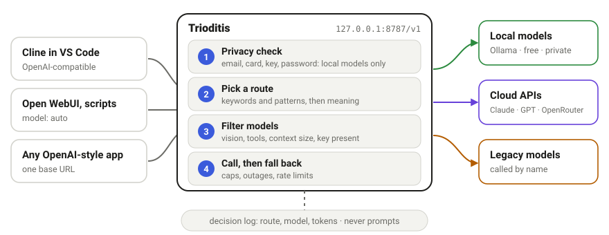

<div align="center">

<picture>
  <source media="(prefers-color-scheme: dark)" srcset="docs/img/banner-dark.svg">
  
</picture>

**A security-first router for LLMs.** One OpenAI-compatible endpoint that sends each prompt to the right model, whether local (Ollama), cloud (Claude, GPT, OpenRouter) or legacy, and keeps sensitive prompts on your machine.

[](https://github.com/alexb-joat/trioditis/actions/workflows/ci.yml)
[](https://github.com/alexb-joat/trioditis/actions/workflows/codeql.yml)


[](LICENSE)

[Quick start](#quick-start) &nbsp;·&nbsp; [How it routes](#how-a-request-is-routed) &nbsp;·&nbsp; [Connect your tools](#connect-your-tools) &nbsp;·&nbsp; [Security](#security-at-a-glance) &nbsp;·&nbsp; [Docs](#documentation)

<sub><i>Trioditis: Hecate of the three ways, who stands where the road splits and decides who goes where.<br>Every prompt reaches the same crossroads here: a local model, a cloud model, or no further.</i></sub>

</div>

<br>

<picture>
  <source media="(prefers-color-scheme: dark)" srcset="docs/img/routing-dark.svg">
  
</picture>

## Why Trioditis

| Private by default | Cost-aware | Small and auditable | Explains itself |
|---|---|---|---|
| Prompts with emails, cards, keys or passwords go to a local model or are rejected. They are never sent to a cloud API by accident. | Daily and monthly caps with automatic local fallback, plus per-provider limits and live spend. | About 3,400 lines and four hash-pinned dependencies. No LiteLLM, no LangChain, no telemetry. | Every response names its route and model. A log records the reasons, with no prompt text. |

## Quick start

**1.** Install [Ollama](https://ollama.com/download) and pull a couple of local models (run it natively, not in Docker):

```bash
ollama pull llama3.2:3b && ollama pull qwen2.5-coder:7b && ollama pull nomic-embed-text
```

**2.** Install Trioditis. Every package must match the hash in the lockfile:

```bash
git clone https://github.com/alexb-joat/trioditis.git && cd trioditis
python3 -m venv .venv && source .venv/bin/activate    # Debian/Ubuntu: sudo apt install python3-venv
pip install --require-hashes --no-deps -r requirements.txt
python -m trioditis init     # writes config.yaml and .env (owner-only); never overwrites
```

<details>
<summary>Windows (PowerShell)</summary>

```powershell
git clone https://github.com/alexb-joat/trioditis.git; cd trioditis
py -3 -m venv .venv; .\.venv\Scripts\Activate.ps1
pip install --require-hashes --no-deps -r requirements.txt
python -m trioditis init
```

</details>

**3.** Check and run, the same on every system:

```bash
python -m trioditis check     # which models are usable
python -m trioditis serve     # http://127.0.0.1:8787/v1, localhost only
```

**4.** Try it:

```bash
python -m trioditis explain "Why does my python function raise KeyError?"     # shows the decision, calls no model
curl -s http://127.0.0.1:8787/v1/chat/completions -H 'Content-Type: application/json' \
  -d '{"model":"auto","messages":[{"role":"user","content":"Write a regex for UK postcodes"}]}'
```

Cloud models are optional: add `ANTHROPIC_API_KEY`, `OPENAI_API_KEY` or `OPENROUTER_API_KEY` to `.env` and they join the routes. A cloud provider without a key is simply skipped.

## How a request is routed

1. **Privacy check.** Built-in detectors (emails, card numbers, IBANs, API keys, private keys, passwords) plus your own keywords and regexes. A hit restricts the request to local models; if none can serve it, it is rejected rather than leaked.
2. **Pick a route** (`code`, `reasoning`, `writing`, `quick`, or your own): keyword and pattern signals, the names of the tools a coding agent offers (`tool_keywords`), then similarity to each route's example prompts using a *local* embedding model, else the default route. An agent's later turns stay on the route its task started on.
3. **Filter and order models** by what the request needs: vision, tool calling, context length, and whether the provider's key is present. A route can keep its listed order or `prefer: cheapest` (local first, then by this request's estimated cost) or `fastest` (median latency of recent calls); a provider that just answered "too many requests" is tried last until its wait is over.
4. **Call the first model and fall back** on outage, rate limit, missing model or spending cap. If no model of the route fits, only another route's model or a local one is used, never a model you call by name only.
5. **Pin the session.** Requests with the same `X-Session-Id` (or `user`) stay on one route, so agents do not switch models mid-task.

Responses carry `X-Trioditis-Route` and `X-Trioditis-Model`. `POST /v1/route` or `trioditis explain "…"` shows the decision and reasons without calling a model. Clients can bypass routing with `model: "route/code"` (force a route), `model: "legacy-mistral"` (call a model directly) or the provider's own id, such as `model: "claude-haiku-5-5"`, which pins an exact version; `X-Trioditis-Upstream-Model` names the id the provider was sent.

## Connect your tools

| Client | Settings |
|---|---|
| **Cline** (VS Code) | Provider *OpenAI Compatible*, base URL `http://127.0.0.1:8787/v1`, model `route/code`. Full recipe, including local-model context: [docs/vscode-cline.md](docs/vscode-cline.md) |
| **Open WebUI, Odysseus, chat UIs** | Add the endpoint `http://127.0.0.1:8787/v1` and pick model `auto` |
| **OpenAI SDKs** | `OpenAI(base_url="http://127.0.0.1:8787/v1", api_key="<your TRIODITIS_API_KEY>")` |

Trioditis speaks the OpenAI chat-completions format, which most tools support. Clients that only speak a provider's native API (for example Claude Code) cannot use it yet.

## Spending and limits

Every cloud call is checked against your daily and monthly caps first (defaults: $1 a day, $15 a month). Over a cap, the route's local model answers instead, so you get an answer, not a bill. `trioditis usage --since 7d --by client` shows what each tool spent. Per-provider caps, provider rate-limit and balance readouts, and call history are in [docs/spending-and-limits.md](docs/spending-and-limits.md). `trioditis hardware` suggests which local models fit your computer ([docs/hardware.md](docs/hardware.md)).

## Security at a glance

| Risk | Control |
|---|---|
| Hijacked dependency | Four direct dependencies, hash-pinned (`--require-hashes`), `pip-audit` in CI, Dependabot with a 7-day hold |
| Router exposed to the network | Binds `127.0.0.1`; refuses any other bind without a 32+ character API key |
| A web page in your browser reaching the router | Foreign `Host` (DNS rebinding) or `Origin` gets 403 and a log line; POST bodies must be JSON |
| Sensitive data sent to the cloud | Detectors force local-only routing or reject |
| Key and prompt leakage | Keys only in environment variables; the client's key is never forwarded; logs hold metadata and a hash, not prompt text |
| Open proxy and SSRF | Upstream URLs come only from `config.yaml`; no redirects followed |
| Supply chain | Actions pinned to commit SHAs, read-only workflows, CodeQL and dependency review on every pull request |

Report a vulnerability privately via [SECURITY.md](SECURITY.md). The full design and its limits are in [docs/security-model.md](docs/security-model.md).

## Platforms

| Linux (systemd) | macOS (launchd) | Windows 10/11 (Scheduled Task) |
|---|---|---|
| Python 3.11+, CI | Python 3.11+, CI | Python 3.11+, CI |

CI runs the unit tests and a real-server smoke test on all three, on Python 3.11, 3.12 and 3.13. To run in the background or in a hardened container, see [docs/deployment.md](docs/deployment.md).

## Documentation

- [VS Code with Cline](docs/vscode-cline.md) · [Spending caps and provider limits](docs/spending-and-limits.md) · [Hardware suggestions](docs/hardware.md)
- [Background service and Docker](docs/deployment.md) · [Security model](docs/security-model.md) · [`config.example.yaml`](config.example.yaml) (providers, models, routes, privacy, limits, logging)

**See every decision live:** [Hlidskjalv](https://github.com/alexb-joat/hlidskjalv) reads the decision log (route, model, tokens, never prompts) and shows it next to your files, commands and Git history.

<details>
<summary>Roadmap</summary>

- [x] Daily and monthly spending caps with local fallback
- [x] Hardware detection and local-model suggestions
- [ ] A small local LLM as an optional classifier for ambiguous prompts
- [ ] Learn from feedback: per-route model scores from thumbs up and down
- [ ] Cost and latency budgets per route
- [ ] Native Anthropic and Gemini adapters (today: their OpenAI-compatible endpoints)
- [ ] Per-user keys and rate limits for team use

</details>

## Contributing

Pull requests are welcome; see [CONTRIBUTING.md](CONTRIBUTING.md). Run the checks with `pip install --require-hashes --no-deps -r requirements-dev.txt && python -m pytest -q`. If Trioditis saves you money or time, the **Sponsor** button at the top of the repository supports it.

## License

[MIT](LICENSE). Not affiliated with Anthropic, OpenAI, Ollama, OpenRouter or any model provider; their names refer only to their public APIs.
